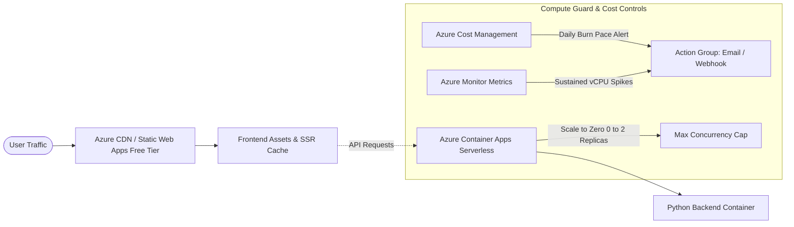

# Azure Low-Cost Deployment & Daily Compute Monitoring Guide

## Architecture Overview



### Why this is the Lowest Cost Azure Architecture:
1. **Frontend (Azure Static Web Apps with integrated Azure CDN)**:
   - **Cost: $0 / Free Tier**
   - Global CDN points of presence (Microsoft Edge Network).
   - Free SSL/TLS certificates and automatic renewal.
   - Built-in GitHub Actions integration.
   - 100 GB/month free bandwidth.

2. **Backend Container (Azure Container Apps - Serverless Consumption)**:
   - **Cost: $0 to < $5/month**
   - **Scale to Zero**: Container scales to 0 replicas during idle periods (0 vCPU / 0 RAM billed).
   - **Free monthly grant**: Includes 180,000 vCPU-seconds and 360,000 GiB-seconds free every month + 2 million free requests.
   - **Concurrency & Resource Limits**: Fixed to `0.25 vCPU` and `0.5 GiB RAM` with `maxReplicas: 2` to prevent runaway compute bills.

3. **Daily Compute Usage & Cost Monitoring**:
   - **Daily Budget Alerts**: Configured via Azure Cost Management to track daily spend pace.
   - **Action Group**: Sends automated alerts to your email or webhooks when 50% (forecasted), 80%, and 100% of the daily limit is reached.
   - **Azure Monitor Metric Alerts**: Tracks CPU usage spikes on Container Apps.

---

## 1. Quick Infrastructure Setup (One-Time)

Run the bootstrap script using the Azure CLI:

```bash
# Login to Azure
az login

# Execute the setup script
./infra/setup-azure.sh
```

This will automatically:
1. Create the Azure Resource Group (`rg-simple-ai-prod`).
2. Deploy the Bicep template (`infra/main.bicep`).
3. Create Azure Container Registry (Basic SKU) and Azure Static Web Apps.
4. Deploy Azure Container Apps with scale-to-zero configuration.
5. Create an Azure Cost Management budget and Action Group.
6. Generate the Service Principal credentials for GitHub Actions.

---

## 2. GitHub Secrets Configuration

In your GitHub repository, navigate to **Settings** > **Secrets and variables** > **Actions** and add:

| Secret Name | Value Description |
| :--- | :--- |
| `AZURE_CREDENTIALS` | The JSON output of the service principal from `setup-azure.sh` |
| `AZURE_STATIC_WEB_APPS_API_TOKEN` | API deployment token for the Azure Static Web App |
| `ACR_LOGIN_SERVER` | Azure Container Registry login server (e.g. `acrsimpleaixyz.azurecr.io`) |
| `ACR_USERNAME` | ACR admin username |
| `ACR_PASSWORD` | ACR admin password |
| `RESOURCE_GROUP` | `rg-simple-ai-prod` |
| `CONTAINER_APP_NAME` | `ca-simple-ai-backend-prod` |

---

## 3. GitHub Actions CI/CD Pipeline

The workflow file is located at [`.github/workflows/azure-deploy.yml`](../.github/workflows/azure-deploy.yml).

### Pipeline Stages:
1. **Validation & Quality Gates**:
   - Installs dependencies using `uv` and verifies backend import integrity.
   - Typechecks and builds the Next.js frontend.
2. **Build & Push Backend Container**:
   - Multi-stage Docker build via Buildx with layer caching.
   - Tags with Git SHA and pushes to Azure Container Registry (ACR).
3. **Deploy Backend to Azure Container Apps**:
   - Runs `az containerapp update` with strict scaling limits (`--min-replicas 0 --max-replicas 2 --cpu 0.25 --memory 0.5Gi`).
4. **Deploy Frontend to Azure CDN**:
   - Deploys static build to Azure Static Web Apps edge network via `Azure/static-web-apps-deploy@v1`.

---

## 4. Daily Compute Limit Monitoring

To configure or adjust daily compute limits and alerts, run:

```bash
DAILY_LIMIT_USD=1.00 ALERT_EMAIL="your-email@example.com" ./infra/setup-daily-cost-guard.sh
```

- Evaluates budget actual and forecasted burn rate daily.
- Alerts trigger immediately when consumption threatens to exceed your daily allowance.
